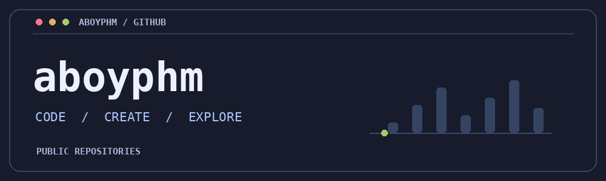

<p align="center">
  
</p>

<h1 align="center">Hi, I'm Aboy</h1>
<p align="center">Building software with care for the whole journey: from analysis and architecture to code and quality.</p>
<p align="center"><a href="https://github.com/aboyphm?tab=repositories">Explore my repositories</a> · <a href="assets/header-static.png">Static header</a></p>

---

### About me

I enjoy turning real-world problems into useful software. My work spans web applications, APIs, data workflows, and the engineering decisions that keep them dependable.

I care about understanding the problem before writing code, testing important paths, and making systems easier to operate. I'm also interested in AI agents and automation that help developers work more effectively.

```text
aboyphm@github
--------------
focus       analysis · architecture · engineering · QA
building    web applications · APIs · data workflows
exploring   AI agents · developer automation
```

### Selected public projects

| Repository | What to explore |
| :--- | :--- |
| [automaticare-fe](https://github.com/aboyphm/automaticare-fe) | TypeScript frontend |
| [automaticare-admin-fe](https://github.com/aboyphm/automaticare-admin-fe) | Admin frontend |
| [automaticare-python-api](https://github.com/aboyphm/automaticare-python-api) | Python API |
| [automaticare-rust-api](https://github.com/aboyphm/automaticare-rust-api) | Rust API |
| [prism](https://github.com/aboyphm/prism) | Internal department and parts management project |
| [undangan-by-pebry](https://github.com/aboyphm/undangan-by-pebry) | Digital invitation project |

### Tools & interests

**Languages in public repositories:** TypeScript · JavaScript · Python · Rust · Java · SCSS  
**Engineering:** React · FastAPI · PostgreSQL · Docker  
**Interests:** System design · testing · data reliability · AI-assisted development

---

<p align="center"><sub>Thanks for stopping by. <a href="https://github.com/aboyphm">github.com/aboyphm</a></sub></p>

<details>
<summary>About the animation</summary>

The decorative header is a GIF generated offline with Anime.js v4 because GitHub README files do not execute JavaScript. For a non-animated version, [view the static header](assets/header-static.png). The GIF cannot automatically respond to reduced-motion settings; all essential information is available as text above.

To regenerate the assets, run `npm ci && node render-header.mjs`. The renderer requires Python 3 with Pillow at `/usr/bin/python3` and DejaVu Sans Mono fonts.

</details>
